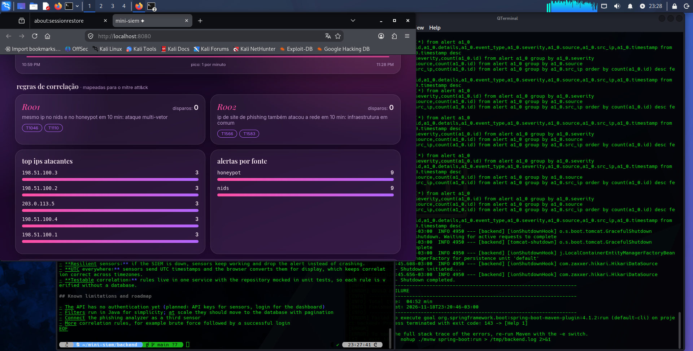
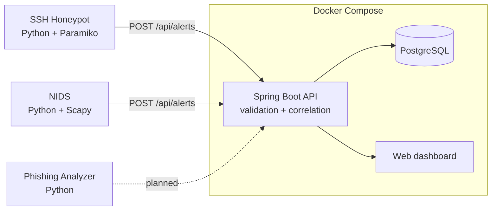

# Mini-SIEM


A lightweight Security Information and Event Management (SIEM) system built from my own security tools. It collects alerts from an SSH honeypot and a network IDS, stores them in PostgreSQL, correlates events across sources and shows everything in a live dashboard.



## Architecture



Every sensor sends alerts in one common JSON format (see `docs/formato-alerta.md`), so adding a new source requires no backend changes.

## Features

- REST API with input validation (Bean Validation)
- Correlation engine with rules mapped to MITRE ATT&CK
- Live dashboard: counters, timeline, top attacking IPs, alerts per source, filters, rule hit counters
- One-command deployment with Docker Compose (multi-stage build, database healthcheck)
- Unit tests and CI on every push (GitHub Actions)

## Tech stack

Java 25, Spring Boot 4, Spring Data JPA, PostgreSQL 16, Docker Compose, GitHub Actions, plain HTML/CSS/JavaScript. Sensors are written in Python (Scapy, Paramiko).

## Correlation rules

| ID   | Condition                                                         | Result                                   | MITRE ATT&CK |
|------|-------------------------------------------------------------------|------------------------------------------|--------------|
| R001 | Same IP seen by the NIDS and the honeypot within 10 minutes       | `multi_vector_attack`, severity high     | T1046, T1110 |
| R002 | Same IP seen by the phishing analyzer and by the NIDS or honeypot | `infrastructure_overlap`, severity high  | T1566, T1583 |

R002 is implemented and unit-tested; it starts firing once the phishing analyzer is connected as a sensor.

## API

| Method | Path               | Description                                                  |
|--------|--------------------|--------------------------------------------------------------|
| POST   | `/api/alerts`      | Ingest an alert (validated)                                  |
| GET    | `/api/alerts`      | List alerts, newest first. Filters: `severity`, `source`, `ip`, `limit` |
| GET    | `/api/stats`       | Totals, counts by severity and source, top attacking IPs     |

Alert format:

```json
{
  "source": "honeypot",
  "timestamp": "2026-11-18T14:30:00Z",
  "srcIp": "203.0.113.5",
  "eventType": "ssh_login_attempt",
  "severity": "medium",
  "details": { "user": "root", "password": "123456" }
}
```

## Run it

```bash
git clone https://github.com/VitoriaChuarts/mini-siem.git
cd mini-siem
cp .env.example .env      # set a strong POSTGRES_PASSWORD
docker compose up -d --build
```

Open http://localhost:8080. Run the tests with `cd backend && ./mvnw test`.

## Sensors

- [SSH Honeypot](https://github.com/VitoriaChuarts/honeypot-ssh): Python and Paramiko, captures attacker credentials
- [NIDS](https://github.com/VitoriaChuarts/nids-python): Python and Scapy, detects port scans and SYN floods

## Design decisions

- **Untrusted data in the UI:** honeypot usernames and passwords come from attackers, so the dashboard renders them with `textContent`, never `innerHTML`, to prevent stored XSS.
- **Secrets out of Git:** the database password lives in `.env` (git-ignored); only `.env.example` is versioned.
- **Smaller attack surface:** multi-stage Docker build, and PostgreSQL is not exposed outside the Compose network.
- **Resilient sensors:** if the SIEM is down, sensors keep working and drop the alert instead of crashing.
- **UTC everywhere:** sensors send UTC timestamps and the browser converts them for display, which keeps correlation correct across timezones.
- **Testable correlation:** rules live in one service with the repository mocked in unit tests, so each rule is verified without a database.

## Known limitations and roadmap

- The API has no authentication yet (planned: API keys for sensors, login for the dashboard)
- Filters run in Java for simplicity; at scale they should move to the database with pagination
- Connect the phishing analyzer as a third sensor
- More correlation rules, for example brute force followed by a successful login
